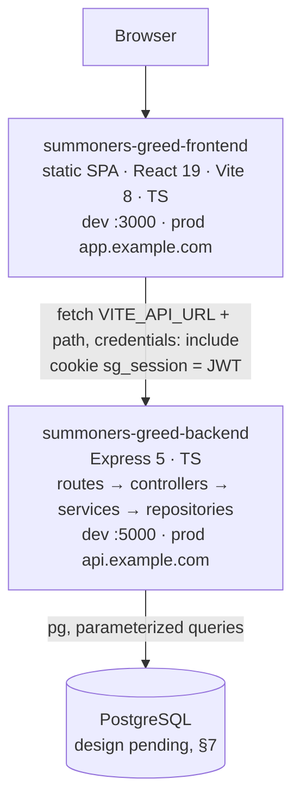

# Summoner's Greed Social — Architecture

> **What this project is:** *Summoner's Greed Social* is a fan-made community social network for players of the mobile game
> **Summoner's Greed**: posts, likes, replies, follows, profiles and news, with admin moderation. Product scope and rules: [`PRD.md`](./PRD.md).
> Stack: **React + Vite + TypeScript, TailwindCSS and shadcn/ui** (frontend), **Express.js** REST API (backend),
> **PostgreSQL** through the `pg` package (database). Two GitHub repositories:
> [`summoners-greed-frontend`](https://github.com/Ice-San/summoners-greed-frontend) ·
> [`summoners-greed-backend`](https://github.com/Ice-San/summoners-greed-backend).
>
> Doc suite: [`PRD.md`](./PRD.md) · `Architecture.md` (this file: system design, API contract, database, security, engineering rules, current state) ·
> [`Design_System.md`](./Design_System.md) · [`Agents.md`](./Agents.md).
> UI/UX reference: <https://summonersgreed-mockup.vercel.app/>.
> Docs last synced with: frontend `development` @ `4367782` · backend `development` @ `566fb7b` · written 2026-10-08.

---

## 1. Tech stack

**Both repos**
- **Language:** TypeScript with `"strict": true`. The `any` type MUST NOT be used without a `// reason:` comment
  (the backend already has `strict`; the frontend doesn't yet, known issue F5).
- **Runtime:** Node.js **22 LTS**, matching CI. Pinned in `.nvmrc` and in `engines`.
- **Package manager:** **pnpm**, pinned with `packageManager` in `package.json` (backend: `pnpm@10.32.1`; the frontend MUST pin the same, F12).
  CI's `pnpm/action-setup` reads that field, so the workflow sets no `version:`. No npm or yarn lockfiles.

**Frontend (`summoners-greed-frontend`)**
- **Installed:** React 19.2, **Vite 8**, TypeScript ~6.0, **React Router 8** (declarative `BrowserRouter` + `Routes`; MUST stay ≥ 8.3.0 because of the
  CSRF fix in SG-4), **TailwindCSS 4.3** via `@tailwindcss/vite`, **lucide-react**, **framer-motion 12**, ESLint 10 (flat config, typescript-eslint,
  react-hooks, react-refresh). Dev server on port **3000**.
- **To add as features need them:** shadcn/ui (Radix; needs the `@/` alias), TanStack Query v5, react-hook-form + zod, sonner,
  Vitest + Testing Library + MSW, Playwright.
- **No Next.js:** no SSR, no Server Components, no `next/*` APIs.

**Backend (`summoners-greed-backend`)**
- **Installed:** **Express 5.2**, **`pg` 8** (node-postgres), cors, dotenv, TypeScript ^7 (built with `tsc` + `tsc-alias` for the `@/` alias),
  `tsx watch` for dev, **Biome 2.5** for lint and format.
- **To add:** zod, **bcrypt** (+ `@types/bcrypt` dev), **jsonwebtoken** (+ `@types/jsonwebtoken` dev), helmet, cookie-parser, express-rate-limit,
  pino + pino-http, Vitest + Supertest.
- **No ORM** (no Prisma, Drizzle, Sequelize or TypeORM). Queries go through `pg`; every other data-access convention is ⏳ pending (§7, DB-6).

**Infrastructure**
- **Database:** PostgreSQL. Version, local setup and production hosting are ⏳ pending (§7, DB-1).
- **CI:** GitHub Actions in both repos (§12). **Hosting (target):** static host/CDN for the SPA, a Node container for the API (§13).

New runtime dependencies SHOULD be justified in the PR description. Prefer what's already installed.

## 2. System integration



- **Frontend** is a static single-page app. It renders every screen and owns the UX. It holds no business data of its own; it reads and writes through the API.
- **Backend** is the only component that touches the database. It owns validation, authentication, authorization and business rules.
- **Two origins, one site.** The SPA and the API run on different origins and talk through CORS with credentials (`origin = FRONTEND_URL`,
  `credentials: true`). The session cookie is `SameSite=Lax`, so in production both MUST be on the same registrable domain
  (`app.example.com` + `api.example.com`). See §5.4.
- The two repos are **independent projects**. They share nothing at build time; the API contract in §6 is the agreement between them.
  Shared types and zod schemas are duplicated on purpose and MUST both match §6.
- **No external services** in the MVP: no OAuth providers, no email sending, no file storage, no game API (PRD.md §5.3).

**What the mockup tells us.** The mockup was built with Next.js + Tailwind v4 + shadcn-style components. **We reuse only its UI, not its framework.**
It keeps all state in `localStorage`, and its shapes are one input for the pending schema design (§7, DB-2): `sg_users` `{ id, username, tag: "@theking", password (plain text),
role, following[], followers[], bio, socials.twitter, createdAt }` · `sg_posts` `{ id, userId, content, likes: userId[], comments[], createdAt }` ·
`sg_news` `{ id, title, content, imageUrl?, createdAt }` · `sg_current_user`. Its routes were `/`, `/login`, `/signup`, `/Home`, `/news`,
`/profile/[username]`, `/dashboard`; PRD.md §4 lists how ours differ (D5, D6, D18).

## 3. Repository layouts

Files marked ✅ exist today. Everything else is the planned structure that new code MUST follow.

### 3.1 `summoners-greed-frontend`

```
summoners-greed-frontend/
├─ .github/workflows/main.yml      ✅ CI: quality (tsc + eslint), build, security (pnpm audit)
├─ index.html                      ✅ Geist from Google Fonts, <div id="root">  (add class="dark" + real <title>, F9)
├─ vite.config.ts                  ✅ react(), tailwindcss(), server.port 3000   (add @ alias, F15)
├─ eslint.config.js                ✅ flat config
├─ tsconfig.json / .app / .node    ✅ (add "strict": true and the @ path alias)
├─ components.json                    shadcn config (when installed)
├─ .env.example                       VITE_API_URL=http://localhost:5000
├─ public/
│  ├─ favicon.svg · icons.svg      ✅
│  └─ imgs/                        ✅ banner.webp (hero), sg.jpg (grid screenshot); add news-fallback.webp
└─ src/
   ├─ main.tsx                     ✅ BrowserRouter + Routes (/, /signin, /signup)
   ├─ globals.css                  ✅ @import "tailwindcss" (add tokens: Design_System.md §2.3)
   ├─ pages/
   │  ├─ home/index.tsx            ✅ landing page "/" → renamed to landing/index.tsx (LandingPage) when the feed is built (F14)
   │  ├─ signin/index.tsx          ✅ SignInPage (UI only)
   │  ├─ signup/index.tsx          ✅ SignUpPage (UI only)
   │  ├─ feed/index.tsx               FeedPage → "/home"
   │  ├─ news/index.tsx               NewsPage → "/news"
   │  ├─ profile/index.tsx            ProfilePage → "/profile/:userTag"
   │  ├─ dashboard/index.tsx          DashboardPage → "/dashboard" (admin)
   │  └─ not-found/index.tsx          NotFoundPage
   ├─ layouts/                        marketing-layout, auth-layout, app-shell (sidebar + mobile tab bar + <Outlet/>)
   ├─ components/
   │  ├─ ui/                          shadcn primitives (button, input, textarea, label, tabs, alert-dialog, dropdown-menu, avatar, skeleton, sonner, tooltip)
   │  ├─ guards/                      require-auth, require-admin, guest-only
   │  ├─ landing/                     hero, community-preview, news-preview, profile-showcase, join-cta (split out of the landing page)
   │  └─ feed/ · profile/ · news/ · admin/
   ├─ lib/
   │  ├─ api/                         client.ts (fetch wrapper + ApiError), one file per resource, query-keys.ts
   │  ├─ validation/                  zod schemas (mirror the backend)
   │  ├─ types.ts                     API types (mirror §6.1)
   │  ├─ format-date.ts               single date helper (PRD D9)
   │  └─ utils.ts                     cn()
   └─ hooks/                          use-me, use-feed, use-like, use-follow …
```

### 3.2 `summoners-greed-backend`

```
summoners-greed-backend/
├─ .github/workflows/main.yml      ✅ CI: quality (tsc + biome ci), build, security (pnpm audit)
├─ biome.json                      ✅ 2 spaces, single quotes, semicolons, trailing commas, width 100
├─ tsconfig.json                   ✅ strict, commonjs, outDir dist, @/* → src/*
├─ package.json                    ✅ scripts: watch (tsx), build (tsc + tsc-alias), start, lint, lint:fix, format
├─ .env.example                       see §9
├─ (database files)                   ⏳ pending: local DB setup, migrations, seed (§7: DB-1, DB-4, DB-5)
├─ tests/                             vitest + supertest integration tests
└─ src/
   ├─ index.ts                     ✅ entry point: imports the app and calls listen() (split out app.ts, B7)
   ├─ app.ts                          express(), middlewares, routes, error handler (exported for tests)
   ├─ config/env.ts                   zod-validated process.env
   ├─ db/                             ⏳ pending: connection and transaction helpers (§7, DB-6)
   ├─ lib/                            password.ts (bcrypt), jwt.ts (sign/verify + cookie options), user-tag.ts (PRD §7.1 generator),
   │                                  pagination.ts (cursor helpers, DB-8), http.ts (ok() / AppError)
   └─ api/
      ├─ routes/                   ✅ users.ts · auth.ts · posts.ts · comments.ts · news.ts · admin.ts   (default-export a Router)
      ├─ controllers/              ✅ users.ts · auth.ts · posts.ts · …                                 (named handlers: getUser, …)
      ├─ services/                    business rules, ownership checks
      ├─ repositories/                SQL only (pg)
      ├─ schemas/                     zod schemas per resource
      └─ middlewares/                 require-auth.ts, require-role.ts, validate.ts, rate-limit.ts, error-handler.ts
```

Each repo is installed, run, tested and deployed on its own (§9, §13).

## 4. Frontend architecture

### 4.1 Routes (React Router 8, declarative mode)

| Path | Layout | Guard | Page | Status |
|---|---|---|---|---|
| `/` | marketing | `GuestOnly` (signed in → `/home`) | `pages/landing` (`LandingPage`) | ✅ UI (as `pages/home`) |
| `/signin` | auth | `GuestOnly` | `pages/signin` | 🟡 UI, no logic |
| `/signup` | auth | `GuestOnly` | `pages/signup` | 🟡 UI with old fields (F18), no logic |
| `/home` | app shell | `RequireAuth` | `pages/feed` | ⬜ |
| `/news` | app shell | `RequireAuth` | `pages/news` | ⬜ |
| `/profile/:userTag` | app shell | `RequireAuth` | `pages/profile` | ⬜ |
| `/dashboard` | app shell | `RequireAuth` + `RequireAdmin` | `pages/dashboard` | ⬜ |
| `*` | — | — | `pages/not-found` | ⬜ |

Route nesting: a `GuestOnly` layout route wraps `/`, `/signin` and `/signup`. A `RequireAuth` layout route wraps an `AppShell` layout route, which
wraps `/home`, `/news`, `/profile/:userTag` and a `RequireAdmin` layout route around `/dashboard`. `*` sits outside every guard.

Guards read `useMe()`, a TanStack Query hook for `GET /auth/me` with `retry: false`; a 401 means a guest. While it loads they show a full-screen skeleton.
They are **UX only**; the API enforces every rule again (PRD D4). `RequireAuth` redirects to `/signin?next=<current path>`. After sign-in, `next` is
followed only if it starts with a single `/` (not `//`, not a full URL).

### 4.2 Data fetching
- **TanStack Query** holds all server state. Query keys: `['me']`, `['feed']`, `['posts', postId, 'comments']`, `['users', userTag]`,
  `['users', userTag, 'posts']`, `['news']`, `['admin', 'users', q]`, `['admin', 'posts']`.
- The feed and profile posts use `useInfiniteQuery` with `nextCursor`, loading the next page when an `IntersectionObserver` sentinel scrolls into view.
- **Optimistic updates** for like/unlike, follow/unfollow and add comment, rolled back on error with a toast.
- Mutations invalidate the related keys (creating a post invalidates `['feed']` and `['users', myUserTag, 'posts']`). Changing your own userTag updates `['me']`,
  removes the old `['users', oldUserTag]` entries and navigates to the new profile URL. Signing in or out resets the cache and sets `['me']`.
- `lib/api/client.ts` is a thin `fetch` wrapper. It prefixes `import.meta.env.VITE_API_URL`, sends `credentials: 'include'` and JSON headers, returns
  `body.data` (and `nextCursor`), and on errors throws a typed `ApiError { status, code, message, details }` built from the error body (§6).
  A 401 from any request other than `/auth/me` clears `['me']`, so the guards redirect to `/signin`.

### 4.3 Shared UI shell (signed in)
`AppShell` is a left **sidebar** (`lg` and up): Home, Explore News, Profile, Dashboard (admin only), a big "Post" button that focuses the composer
(or opens a compose dialog when you're not on `/home`), and a user chip with a menu (Log out). Below `lg` it becomes a **bottom tab bar** plus a
floating Post button. Details: Design_System.md §6.4.

## 5. Security and authentication

### 5.1 Sessions (stateless JWT in a cookie)
Sessions are **stateless JWTs kept in a browser cookie**. There is **no `sessions` table**: the server stores nothing per sign-in, and the signed token
in the cookie is the whole session (PRD D3).

- **Sign up** `POST /auth/signup` `{ email, username, password }`: validate → `bcrypt.hash(password, BCRYPT_ROUNDS)` → generate userTag candidates from the
  username (PRD §7.1, `lib/user-tag.ts`) → create the user (`role = user`) with the first free candidate, moving to the next one when it is taken, including when a
  parallel sign-up takes it first (max 10 attempts; how uniqueness is enforced is DB-2); an email already registered → 409 → sign a JWT → set the cookie → 201 `Me`.
- **Sign in** `POST /auth/signin` `{ email, password }`: find the user by email, case-insensitively (how: DB-2) → `bcrypt.compare(password, storedHash)`;
  with an unknown email, still compare against a fixed dummy hash so timing doesn't reveal which emails exist → sign a JWT → set the cookie.
  Any failure → 401 "Invalid email or password".
- **Token** (`src/lib/jwt.ts`, `jsonwebtoken`):
  - **HS256**, signed with `JWT_SECRET` (env, required, at least 32 random bytes, e.g. `openssl rand -base64 48`; validated in `config/env.ts`).
  - Claims: `sub` (user id), `iat`, `exp` (now + `JWT_TTL_DAYS`, default 7). **No email, role or other user data:** a JWT is only base64-encoded, and the
    role is always read fresh from the DB.
  - Verify with `algorithms: ['HS256']` pinned, so `alg: none` or a swapped algorithm is rejected.
  - **Rolling renewal:** if a valid token has less than 3 days left, `requireAuth` signs a fresh one and re-sets the cookie. No refresh tokens.
- **Cookie** `sg_session`: `httpOnly; Secure (prod); SameSite=Lax; Path=/; Max-Age=604800` (matches `JWT_TTL_DAYS`). No `Domain` attribute, so it is
  host-only on the API host. Because it is `httpOnly`, **frontend JavaScript can't read it**; the token is never in a response body, a URL, logs or
  `localStorage`. The SPA learns who is signed in only through `GET /auth/me`.
- **Sign out** `POST /auth/signout`: `res.clearCookie('sg_session', sameOptions)` → 204. No `requireAuth`, so it always succeeds, even with an expired token.
- **Known limitation (accepted):** a JWT can't be revoked before `exp`. Sign-out removes the cookie from *this* browser, but a copied token stays valid
  until it expires (at most `JWT_TTL_DAYS`). Changing a password doesn't sign out other devices. Rotating `JWT_SECRET` signs out everyone. If per-user
  revocation is needed later: store a per-user token version, put it in the JWT, compare it in `requireAuth`, increment it on password change. Still no session table.

### 5.2 Authorization
- **`requireAuth`**: read the cookie → verify the JWT (signature, `exp`, algorithm) → load the user by id from the database
  → `req.user`. A missing, malformed, tampered or expired token, or a `sub` that no longer exists → 401 and the cookie is cleared. Loading the user on every
  request means a **deleted user is signed out immediately** and role changes apply on the next request. Authorization always uses this row, never token claims.
- **`requireRole('admin')`**: 403 if `req.user.role !== 'admin'`.
- **Ownership** (in services): deleting a post or comment requires `author_id === req.user.id || role === 'admin'`.

### 5.3 Passwords
- **bcrypt**, cost `BCRYPT_ROUNDS` (default 12). Only the async `bcrypt.hash` / `bcrypt.compare` (the `*Sync` versions block the event loop).
- 8–72 bytes (PRD §7). The hash never leaves the backend.

### 5.4 Cross-origin and cookies
- CORS MUST allowlist exactly `FRONTEND_URL` (env, not hard-coded), with `credentials: true` and methods `GET, POST, PUT, PATCH, DELETE`.
  Every frontend request MUST use `credentials: 'include'`.
- `SameSite=Lax` cookies are only sent within the same *site*. In dev, `localhost:3000` → `localhost:5000` is same-site. In production the frontend and API
  MUST share a registrable domain (`app.example.com` + `api.example.com`); otherwise every authenticated request fails with 401.
- State-changing requests MUST be `POST`/`PUT`/`PATCH`/`DELETE` with `Content-Type: application/json`. `GET` never mutates. Together with `SameSite=Lax`
  and the exact CORS allowlist, this is the CSRF defence.
- Cookie options: `httpOnly`, `secure` in production (`COOKIE_SECURE`), `sameSite: 'lax'`, `path: '/'`. Clearing uses the same options.

### 5.5 Data protection
- `email` appears only in the current user's own `Me` payload (sign-up, sign-in, `GET /auth/me`, `PATCH /users/me`) and in admin user rows. Never on public
  profiles, posts or comments. Responses never include `passwordHash` or the JWT.
- Render user content as text only. Never `dangerouslySetInnerHTML` with user input. Line breaks are kept with `whitespace-pre-wrap`.
- `helmet` defaults. `app.set('trust proxy', 1)` behind a proxy. Logs (pino) redact `password`, `cookie`, `set-cookie` and `authorization`.
- Password inputs are `type="password"` with `autocomplete="current-password"` / `"new-password"`. Email inputs are `type="email"`.
- Frontend env vars are public (`import.meta.env.VITE_*` ends up in the bundle). Secrets MUST NOT go in the frontend `.env`.
- Rate limits (PRD §7): auth 10/min per IP, writes 60/min per user (`express-rate-limit`).
- `pnpm audit --prod` runs in CI in both repos. High/critical advisories block merging.

## 6. API contract

Base URL: `VITE_API_URL` (dev `http://localhost:5000`). Routes are mounted at the root, no `/api` prefix (PRD D20). JSON only.
Timestamps are ISO-8601 UTC. IDs are UUIDs. Keys are `camelCase`.

**Response shape.** Extends the shape the backend already returns (`{ status, message }`) (PRD D19):
```jsonc
// success, single resource
{ "status": 200, "message": "User has been retrieved successfully!", "data": { } }
// success, paginated list
{ "status": 200, "message": "Posts have been retrieved successfully!", "data": [ ], "nextCursor": "opaque-or-null" }
// error
{ "status": 400, "message": "Invalid request", "code": "VALIDATION_ERROR", "details": { "userTag": ["User tag must be 3–20 characters: a–z, 0–9 or _"] } }
{ "status": 409, "message": "This user tag is already taken.", "code": "CONFLICT" }
```
- `status` always equals the HTTP status. `message` is human-readable and MAY be shown in a toast. **204 responses have no body.**
- Codes: `VALIDATION_ERROR` (400) · `UNAUTHENTICATED` (401) · `FORBIDDEN` (403) · `NOT_FOUND` (404) · `CONFLICT` (409) · `UNPROCESSABLE` (422) ·
  `RATE_LIMITED` (429) · `INTERNAL` (500).
- Responses are built with one helper, `ok(res, status, message, data?, nextCursor?)`. Errors are thrown as `AppError(status, code, message, details?)` and
  formatted by the error middleware.

**Pagination.** `?limit=20&cursor=<opaque>`; default 20, max 50. The cursor is opaque to the frontend: it sends back the `nextCursor` it received, and `null`
means there is no next page. Lists are newest first (comments oldest first). What the cursor encodes and how pages are queried is ⏳ pending (§7, DB-8).

### 6.1 Resource shapes (the `data` field)

```ts
type PublicUser = {
  id: string; username: string; userTag: string;         // userTag without "@"
  bio: string; twitterHandle: string | null; role: "user" | "admin";
  createdAt: string;
  followersCount: number; followingCount: number; postsCount: number;
  isFollowing: boolean;                                   // relative to the current user
  isMe: boolean;
};
type Me = PublicUser & { email: string };                 // only ever returned for the current user
type AuthorSummary = { id: string; username: string; userTag: string };
type Post = {
  id: string; content: string; createdAt: string;
  author: AuthorSummary;
  likesCount: number; commentsCount: number; likedByMe: boolean;
  canDelete: boolean;
};
type Comment = { id: string; postId: string; content: string; createdAt: string; author: AuthorSummary; canDelete: boolean };
type News = { id: string; title: string; content: string; imageUrl: string | null; createdAt: string; author: AuthorSummary | null };
type AdminUserRow = { id: string; username: string; userTag: string; email: string; role: "user" | "admin"; followersCount: number; postsCount: number; createdAt: string };
```

### 6.2 Endpoints

| Method | Path | Auth | Body / query | Success (`data`) | Notes / errors |
|---|---|---|---|---|---|
| POST | `/auth/signup` | guest | `{ email, username, password }` | 201 `Me` + cookie | userTag generated (PRD §7.1); 409 "This email is already registered."; rate-limited |
| POST | `/auth/signin` | guest | `{ email, password }` | 200 `Me` + cookie | 401 "Invalid email or password"; rate-limited |
| POST | `/auth/signout` | public | — | 204 | clears `sg_session`; works with an expired token |
| GET | `/auth/me` | user | — | 200 `Me` | 401 if the cookie is missing/invalid/expired or the user was deleted |
| GET | `/users/:userTag` | user | — | 200 `PublicUser` | 404 "User not found" |
| PATCH | `/users/me` | user | `{ username?, userTag?, bio?, twitterHandle? }` | 200 `Me` | userTag: leading `@` stripped, lowercased; 409 "This user tag is already taken." (also for reserved tags); `twitterHandle: null` clears it |
| GET | `/users/:userTag/posts` | user | `limit, cursor` | 200 `Post[]` | newest first; 404 if the user doesn't exist |
| PUT | `/users/:userTag/follow` | user | — | 204 | idempotent (`ON CONFLICT DO NOTHING`); 422 "You cannot follow yourself." |
| DELETE | `/users/:userTag/follow` | user | — | 204 | idempotent |
| GET | `/posts` | user | `limit, cursor` | 200 `Post[]` | "For you" feed: all posts, newest first |
| POST | `/posts` | user | `{ content }` | 201 `Post` | 1–500 chars trimmed |
| DELETE | `/posts/:id` | owner/admin | — | 204 | 403 if not owner and not admin; 404 if missing |
| PUT | `/posts/:id/like` | user | — | 200 `{ likesCount, likedByMe: true }` | idempotent |
| DELETE | `/posts/:id/like` | user | — | 200 `{ likesCount, likedByMe: false }` | idempotent |
| GET | `/posts/:id/comments` | user | `limit, cursor` | 200 `Comment[]` | **oldest first** (conversation order) |
| POST | `/posts/:id/comments` | user | `{ content }` | 201 `Comment` | 1–280 chars trimmed |
| DELETE | `/comments/:id` | owner/admin | — | 204 | 403 if not owner and not admin |
| GET | `/news` | user | `limit, cursor` | 200 `News[]` | newest first (would become public for PRD D14) |
| GET | `/admin/users` | admin | `limit, cursor, q?` | 200 `AdminUserRow[]` + `total` | `q` searches username and userTag (case-insensitive "contains"; query is DB-6) |
| DELETE | `/admin/users/:id` | admin | — | 204 | `:id` is a UUID; 422 "You cannot delete yourself." |
| GET | `/admin/posts` | admin | `limit, cursor` | 200 `Post[]` + `total` | all posts for moderation |
| POST | `/admin/news` | admin | `{ title, content, imageUrl? }` | 201 `News` | message "News published successfully!" |
| DELETE | `/admin/news/:id` | admin | — | 204 | SHOULD (API only in MVP; UI is Phase 2) |
| GET | `/health` | public | — | 200 `{ db: "ok" }` | checks the database connection |

- The existing stub routes `GET /users` and `GET /users/:id` are placeholders. They become `GET /admin/users` and `GET /users/:userTag`.
- `total` sits next to `data` on the two admin list endpoints and feeds the "Users List (N)" / "All Posts (N)" headings.
- `/users/me` is matched before `/users/:userTag`; `me` can never be a userTag because it is shorter than 3 characters.
- Changes to this contract MUST update this section in the same PR (§10.2).

## 7. Data models — ⏳ PENDING

> **Status: pending.** The database design is **not decided**. Only the items in §7.1 are settled. Everything in §7.3 is an open decision, and other
> sections point to it as **DB-n**. Nobody (human or agent) creates tables, migrations, seed data or database tooling until the DB-n items it needs
> are decided and written here.
> An earlier schema draft is in `archive/architecture.md` §7. It is **not adopted**; use it only as input when deciding DB-2.

### 7.1 Decided
- **PostgreSQL** is the database. The backend talks to it with the **`pg`** package (node-postgres); **no ORM**.
- **IDs are UUIDs** (confirmed 2026-10-08). How they are generated is part of DB-2.
- **No sessions table.** Sessions are JWTs in a cookie (§5.1, PRD D3).
- **Only the backend** touches the database, and every query is **parameterized** (§5.5). Never build SQL from user input.

### 7.2 What the product needs to store
This is the data the features in the PRD use, taken from the API shapes in §6.1. It is **not a schema**: how it maps to tables, columns and types is DB-2.

| Thing | Data the product uses | Product rules (PRD §7) |
|---|---|---|
| User | id, email, username, userTag, password hash, role, bio, Twitter/X handle, join date | email unique (case-insensitive); userTag unique; role `user` or `admin` |
| Post | id, author, content, created date | 1–500 chars; author or admin deletes |
| Comment | id, post, author, content, created date | 1–280 chars; flat; author or admin deletes |
| Like | which user liked which post | one per user per post |
| Follow | which user follows which user | one per pair; not yourself |
| News | id, author (may be empty), title, content, image URL, created date | admin only; image URL `https://` |

Product behaviour the design must support: deleting a user removes their posts, comments, likes and follows, and keeps their news with no author;
lists are newest first (comments oldest first) with cursor pagination; posts and profiles show like, comment, follower and post counts.

### 7.3 Pending decisions

| ID | To decide | Input we already have | Blocks |
|---|---|---|---|
| DB-1 | PostgreSQL version; how it runs locally (Docker, local install, …); production provider and backups | none decided | local setup (§9), CI (§12), deployment (§13) |
| DB-2 | Schema: tables, columns, types, defaults, constraints, indexes; how case-insensitive email and unique userTag are enforced; UUID generation; where the reserved-userTag list lives | §7.2, PRD §7, archived draft | every endpoint |
| DB-3 | How the delete rules in §7.2 are carried out (database vs service code); whether counts are computed per query or stored | §7.2 | admin delete user, post/comment delete, feed and profile counts |
| DB-4 | Migrations: tool or hand-written runner, file naming, `package.json` scripts, when they run on deploy | none decided | all DB work |
| DB-5 | Demo/seed data: whether to have it, what it contains, how the first admin is created, where its passwords come from | the mockup's characters: *The Evil Summoner* `@summoner` (admin), *The King* `@theking`, the "Slime King level 400" post, and two news items ("Patch 1.5.0: New Mythic Event", "Maintenance Notice") | local dev, e2e tests, admin access |
| DB-6 | Data-access conventions: pool settings, transaction helper, table/column naming, query rules, how database errors map to API errors (§6) | §10.1 layering (SQL only in `repositories/`) | backend repositories, error handler |
| DB-7 | Test database: a separate database or not, reset/cleanup between tests, database in CI | none decided | backend tests, CI Tests job |
| DB-8 | Pagination internals: what the opaque cursor encodes and how pages are queried | API side (§6): opaque `cursor`, `limit` 20/50, newest first, ties broken consistently | every list endpoint |
| DB-9 | Database environment variables (connection strings, seed passwords) | none decided | §9 |

When an item is decided: write the decision here (replace its row with a "Decided" entry in §7.1 or a new subsection), update every section that points to
it, and log it on the project's Notion page.

## 8. Backend request pipeline

```
helmet → cors({ origin: FRONTEND_URL, credentials: true }) → pino-http (redacted) → express.json({ limit: '100kb' }) → cookie-parser
→ rate-limit (auth routes, write routes) → router → validate(zod: body, params, query; unknown fields stripped) → requireAuth / requireRole
→ controller → service → repository (pg)
→ errorHandler (AppError → { status, message, code, details }; ZodError → 400; database errors → API errors as decided in DB-6; unknown → 500 without the stack)
```

## 9. Configuration and local development

**Backend `.env.example`**
```
NODE_ENV=development
PORT=5000
# ⏳ database variables: pending (§7, DB-9)
FRONTEND_URL=http://localhost:3000
JWT_SECRET=                   # required; >= 32 random bytes (openssl rand -base64 48). Never commit it.
JWT_TTL_DAYS=7
BCRYPT_ROUNDS=12
COOKIE_SECURE=false
LOG_LEVEL=info
```
`src/config/env.ts` parses this with zod, with defaults (e.g. `PORT` → 5000), and fails at startup if anything required is missing. The app reads config only from there.

**Frontend `.env.example`** (`VITE_*` vars are public; they're bundled into the client)
```
VITE_API_URL=http://localhost:5000
```

**Running locally (two terminals, two repos)**
```
# summoners-greed-backend
pnpm install
# ⏳ database setup, migrations and seed: pending (§7: DB-1, DB-4, DB-5)
pnpm watch                    # tsx watch src/index.ts → http://localhost:5000

# summoners-greed-frontend
pnpm install
pnpm dev                      # vite → http://localhost:3000
```

## 10. Engineering rules

### 10.1 Repository layout and naming
- **Two independent repositories.** Nothing is imported between them. Shared contracts (types, zod schemas) are duplicated on purpose and both MUST match §6.
- **Frontend:** each page is `src/pages/<page>/index.tsx` with a **named** export (`export const SignInPage = () => …`). Page folders are lowercase single
  words (`signin`, `signup`, `landing`). Reusable pieces go in `src/components/<area>/`, shadcn primitives in `src/components/ui/`. Global styles in
  `src/globals.css`. Static assets in `public/imgs/`.
- **Backend:** layered by type under `src/api/`: `routes/<resource>.ts` (default-exports a `Router`), `controllers/<resource>.ts` (named handlers),
  `services/`, `repositories/`, `schemas/`, `middlewares/`. Resource files are **plural** (`users.ts`, `posts.ts`). **SQL lives only in `repositories/`.**
  Controllers call services, services call repositories, only repositories touch `pg`.
- Imports use the `@/` alias in both repos. Components `PascalCase`; hooks `useXxx`; other files lowercase/kebab-case.
- **Database naming:** ⏳ pending (§7, DB-6). **API JSON:** `camelCase`.
- **Env vars:** `SCREAMING_SNAKE_CASE`. Each repo keeps `.env.example` current. Real `.env` files, `dist/` and `.DS_Store` MUST be git-ignored.

### 10.2 API rules
- REST, JSON in and out, routes mounted at the root (PRD D20). Every endpoint MUST use the §6 response and error shapes.
- Validate every `body`, `params` and `query` with zod before the controller runs. Unknown fields are stripped.
- Status codes: 200/201/204 success · 400 malformed · 401 not signed in · 403 wrong role/not owner · 404 not found (also for things you may not see) ·
  409 conflict (taken email/userTag) · 422 business-rule violation · 429 rate-limited · 500 unexpected.
- List endpoints MUST be paginated (cursor, default 20, max 50). Never unbounded lists.
- Changes to the API contract MUST update §6 in the same PR.

### 10.3 Database rules
- ⏳ **Pending (§7).** Until the DB-n items are decided, only §7.1 applies: PostgreSQL through `pg`, no ORM, only the backend touches the database.
- **Parameterized queries only.** Never concatenate or interpolate user input into SQL. Dynamic identifiers (sort column, direction) come from a hard-coded allowlist.
- Nobody changes a shared database's structure by hand. How structure changes are made is DB-4.

### 10.4 Frontend rules
- Three layout routes: marketing (`/`), auth (`/signin`, `/signup`) and app (`/home`, `/news`, `/profile/:userTag`, `/dashboard`) (§4.1).
- In-app navigation MUST use `<Link>` / `useNavigate`, never `<a href="./…">`. Buttons that navigate are `<Link>`s styled as buttons.
- Route guards are components (`RequireAuth`, `RequireAdmin`, `GuestOnly`) reading the `['me']` query.
- All API calls go through `src/lib/api/` with `VITE_API_URL`. Server state goes through TanStack Query. Likes, follows and comments SHOULD update
  optimistically and roll back on error.
- Forms use react-hook-form + zod, mirroring the backend schemas. Field errors under the inputs; API errors in a toast (or under the field for 409s).
- Styling uses Tailwind with the **design tokens** (Design_System.md). New code MUST NOT use hard-coded hex values. Don't add colors without updating Design_System.md.
- Build UI from shadcn/ui primitives. Don't fork them for one-off tweaks; pass `className`.
- Animations use framer-motion inside `<MotionConfig reducedMotion="user">` at the app root.
- Every data-driven page MUST have loading (skeleton), empty and error states.
- Accessibility: semantic elements, `aria-label` on icon-only buttons, visible focus ring, keyboard-operable menus and dialogs, labels on inputs (MAY be
  visually hidden), alt text on images, `prefers-reduced-motion` respected (Design_System.md §10).
- Responsive from 360 px to 1920 px. Sidebar at `lg` and up, bottom tab bar below `lg` (PRD D15).

### 10.5 Quality and testing rules
- **Lint/format:** frontend ESLint (`pnpm lint`); backend Biome (`pnpm lint`, `pnpm lint:fix`, `pnpm format`) with 2 spaces, single quotes, semicolons,
  trailing commas, 100 columns. Code MUST pass its repo's linter. The frontend SHOULD adopt Biome formatting with the same settings.
- **Tests (none exist yet).** Each repo MUST get a real `test` script and a CI test job before feature work on auth/posts lands.
  - Backend: every endpoint gets Vitest + Supertest integration tests against a test database (setup pending, DB-7). Cover the happy path, validation (400), auth (401:
    missing, tampered, expired and wrong-algorithm JWTs, and a deleted user's JWT), permission (403) and the business-rule errors in PRD §7.
    Logic with branches gets unit tests: the userTag generator (the six PRD §7.1 cases), follow, like toggle, the delete rules (§7.2).
  - Frontend: Vitest + Testing Library component tests for the auth forms, composer, post card actions, profile edit form and dashboard tabs (API mocked with MSW).
  - E2E (Playwright): the critical paths in §12.

### 10.6 Docs rules
- `PRD.md`, `Architecture.md`, `Design_System.md` and `Agents.md` are kept in sync with both repos. A PR that changes behaviour, the schema, the API or
  tokens updates them in the same PR.

## 11. Git workflow

- Branches: `main` (release), **`development`** (integration), and one branch per ticket named after its ID: **`SG-<n>`** (e.g. `SG-4`).
  Branch from `development`; open the PR into `development`. `development` is merged into `main` for releases.
- Commit messages: **`SG-<n> | <Area> | <Summary>`**, where `<Area>` is exactly `Front-End` or `Back-End`. Example: `SG-4 | Front-End | Signin Page`.
  (Older commits use mixed spellings like `FrontEnd` or `Front End`; use the canonical ones from now on.)
- PRs are small, have a description, and include screenshots for UI changes. A red CI blocks merging. Humans review and merge (Agents.md §4).

## 12. Testing and CI

**CI today** (`.github/workflows/main.yml` in both repos), on push and PR to `development` and `main`, Node 22 + pnpm, three jobs:

| Job | Frontend | Backend |
|---|---|---|
| Quality & Type Checking | `pnpm exec tsc --noEmit` + `pnpm lint` (ESLint) — should become `tsc -b` (F13) | `pnpm exec tsc --noEmit` + `pnpm exec biome ci .` |
| Build Validation | `pnpm run build` (`tsc -b && vite build`) | `pnpm run build` (`tsc && tsc-alias`) |
| Security Scan | `pnpm audit --prod` | `pnpm audit --prod` |

**To add**
- A **Tests** job in both repos. How the backend job gets a database is ⏳ pending (DB-7).
- Backend: Vitest + Supertest against the exported `app` (`src/app.ts`) with a test database. Setup and cleanup between tests are ⏳ pending (DB-7).
- Frontend: Vitest + Testing Library (jsdom), API mocked with MSW.
- **E2E (Playwright)** in the frontend repo's `e2e/`, against `vite preview` plus the real API with test data (DB-5, DB-7). Critical paths:
  1. Sign up (Email, Username, Password) → see the generated @userTag → post → like → reply → follow another summoner → edit profile (change userTag, URL changes) → sign out.
  2. Admin: delete a post → publish news (appears on `/news`) → delete a user (their session is rejected on the next request).

## 13. Deployment (target)
- **Frontend:** `pnpm build` → static files in `dist/`, served from a static host/CDN at `app.<domain>` with an SPA fallback (unknown paths → `index.html`).
  `VITE_API_URL=https://api.<domain>` is set at build time.
- **Backend:** a Node container (Render / Railway / Fly.io) at `api.<domain>`. On release: run migrations (how: DB-4), then `pnpm start` (`node dist/index.js`).
- **Same site:** both MUST share a registrable domain (§5.4).
- **`JWT_SECRET`** is a secret in the host's env, different per environment. Rotating it signs everyone out.
- **Database:** ⏳ pending (§7, DB-1).
- HTTPS only, with `COOKIE_SECURE=true` and `trust proxy` enabled.

## 14. Current state and known issues

### 14.1 What's built

| Repo | Branch | Done | Commits |
|---|---|---|---|
| frontend | `development` @ `4367782` (`main` only has the Vite starter + CI) | Landing page (all sections, static, framer-motion); sign-in and sign-up pages (UI only); routing for `/`, `/signin`, `/signup`; CI | SG-3 (landing), SG-4 (sign-in + React Router CSRF fix), SG-5 (sign-up) |
| backend | `development` = `main` @ `566fb7b` | Express 5 app with CORS for `localhost:3000`; stub `GET /users` and `GET /users/:id` returning `{ status, message }`; Biome; CI. `pg` installed but unused | "First commit", "CI configuration" |

**Not started:** database (design ⏳ pending, §7), authentication, every feature endpoint, every signed-in page (feed, news, profile, dashboard),
shadcn/ui and TanStack Query setup, design tokens, tests.

### 14.2 Known issues to fix (the docs win over code, PRD §3)

**Frontend**
| # | Where | Problem | Fix |
|---|---|---|---|
| F1 | `src/pages/signin/index.tsx`, `src/pages/signup/index.tsx` | Password inputs are `type="text"`, so passwords show in clear text | `type="password"` + `autocomplete`; email inputs `type="email"` |
| F2 | same | Forms have no `onSubmit`, no labels, no error display | react-hook-form + zod, visually-hidden `<label>`s, field errors (§10.4) |
| F3 | same | `<a href="./signup">` / `<a href="./signin">` do a full page reload | `<Link to="/signup">` from `react-router` |
| F4 | `src/pages/home/index.tsx` | "Let's Start", "Let's Start!" and "Join the Cult!" go nowhere | Router links: nav → `/signin`; hero and CTA → `/signup` |
| F5 | `tsconfig.app.json` | No `"strict": true` | Turn it on and fix the errors |
| F6 | all pages | Hard-coded hex colors (`bg-[#120e16]`, `text-[#ffc107]` …) | Add tokens to `src/globals.css` and migrate with Design_System.md §2.5 |
| F7 | `src/pages/home/index.tsx` (hero CTA) | `text-background` has no token, so the class does nothing | Define tokens (F6); CTA text becomes `text-primary-foreground` |
| F8 | `src/globals.css` | Geist is applied through a selector list, so `input`, `label`, `li`, `textarea` fall back to the browser font | Set `--font-sans` in `@theme`, drop the selector list (Design_System.md §3) |
| F9 | `index.html` | `<html>` has no `class="dark"`; `<title>` is "summonersgreed" | `<html lang="en" class="dark">`, `<title>Summoner's Greed Social</title>` |
| F10 | `src/pages/home/index.tsx` | Class typos that do nothing: `flez`, `justify-Start`, `justify-content-end`, a dangling `md:` in the h1, `text-secondary` with no token | Clean up |
| F11 | `src/pages/home/index.tsx` | Footer links have `href=""`; labels "HomePage"/"UserAgreement" differ from the mockup | `href="#"` until the pages exist; "Homepage", "User Agreement" |
| F12 | `.github/workflows/main.yml` | pnpm 11 in one job, 9 in others; no `packageManager` pin | Add `"packageManager": "pnpm@10.32.1"`, remove `version:` from the workflow |
| F13 | `.github/workflows/main.yml` | `tsc --noEmit` on the root `tsconfig.json` (`files: []` + references) most likely checks nothing | `pnpm exec tsc -b` |
| F14 | `src/pages/home/` | Landing component `Home` in `pages/home` is confusing next to the `/home` feed route | Rename to `pages/landing` / `LandingPage` when the feed is built |
| F15 | `vite.config.ts`, `tsconfig.app.json` | No `@/` alias (shadcn needs it) | Add `resolve.alias` and `compilerOptions.paths` |
| F16 | `src/pages/home/index.tsx` | Animations ignore `prefers-reduced-motion` | `<MotionConfig reducedMotion="user">` at the root |
| F17 | `src/pages/signin/index.tsx`, `src/pages/signup/index.tsx` | "Or continue with" + Google / X.com buttons offer OAuth, which is out of scope (PRD D10) | Remove them |
| F18 | `src/pages/signup/index.tsx` | Sign-up fields are Email, **Tag** ("Tag (e.g. king)"), Password; PRD D1 now asks for a Username and generates the userTag | Replace the Tag field with **Username** (placeholder "Username (e.g. The King)", 2–30 chars, `autocomplete="nickname"`) |

**Backend**
| # | Where | Problem | Fix |
|---|---|---|---|
| B1 | `src/index.ts` | `const { PORT } = process.env \|\| 5000` never falls back to 5000; with no `PORT`, `listen(undefined)` picks a random port | `PORT` from `config/env.ts` with default 5000 |
| B2 | `src/index.ts` | CORS origin hard-coded; no `credentials: true`; no `PATCH` | `cors({ origin: env.FRONTEND_URL, credentials: true, methods: ['GET','POST','PUT','PATCH','DELETE'] })` |
| B3 | `src/api/controllers/users.ts` | `typeof Number(id) !== 'number'` is never true (NaN is a number), and IDs are UUIDs | Validate params with zod; 404 with `code: 'NOT_FOUND'` |
| B4 | `package.json` | `cors` and `dotenv` are dev dependencies but needed at runtime | Move to `dependencies` |
| B5 | repo | `dist/` and `.DS_Store` are committed | `.gitignore` them and `git rm -r --cached dist .DS_Store` |
| B6 | `package.json` | `test` script exits with an error; no tests | Vitest + Supertest (§12) |
| B7 | `src/index.ts` | App creation and `listen()` in one file, so tests can't import the app | Split into `src/app.ts` + `src/index.ts` |
| B8 | repo | No `.env.example` | Add one (§9) |
| B9 | `src/index.ts` | No error handler, request logging or `helmet` | Add the §8 pipeline |
